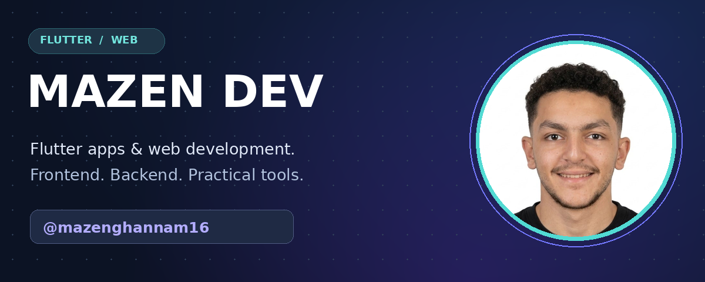

I develop Flutter apps and websites, working across frontend and backend. My toolkit includes Firebase, SQL, JavaScript, HTML, PHP and Python.

## My toolkit

## Selected projects

### [Image analysis experiment](https://github.com/mazenghannam16/mazen-ai-studioo)
A React and TypeScript app that sends images to Gemini for analysis.

### [Dynamic link generator](https://github.com/mazenghannam16/htmlgenertaor)
An Arabic web tool for generating URLs from a list of links.

### [Image-link extractor](https://github.com/mazenghannam16/iframe_code)
An Arabic web tool for extracting image links and names from HTML, with copy controls.

---

أهلًا، أنا مازن. مطور تطبيقات Flutter ومواقع، وبشتغل على الفرونت إند والباك إند.
